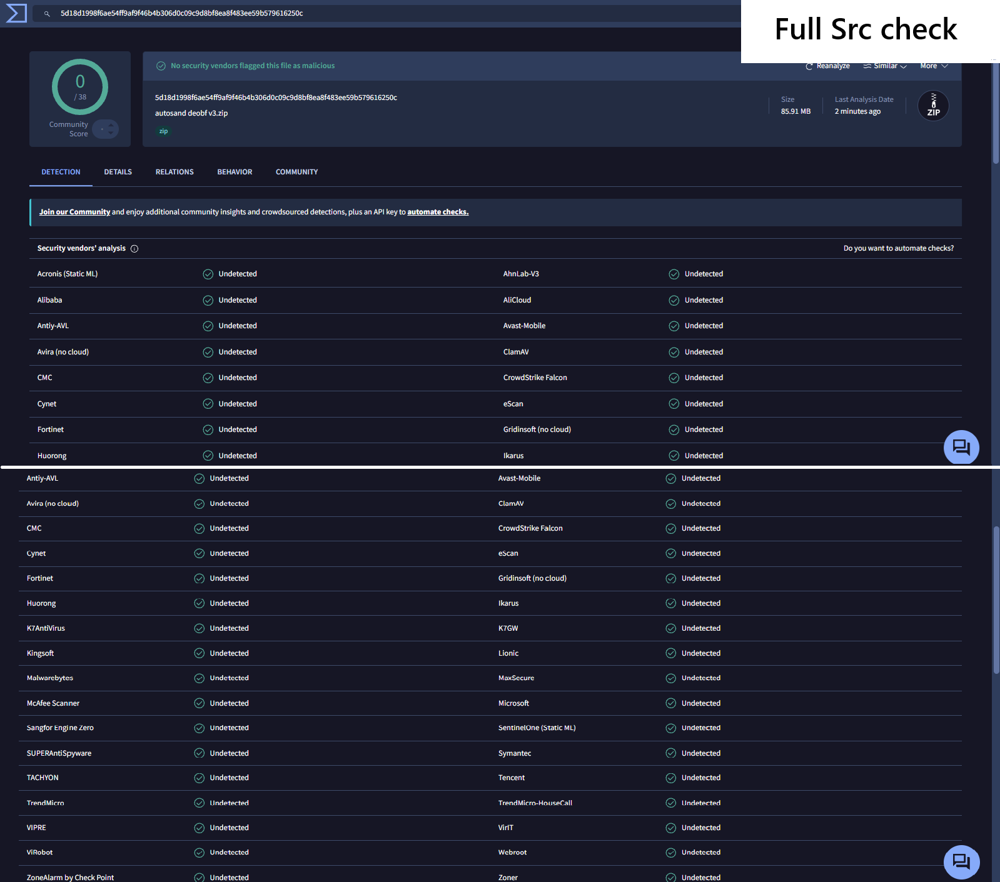
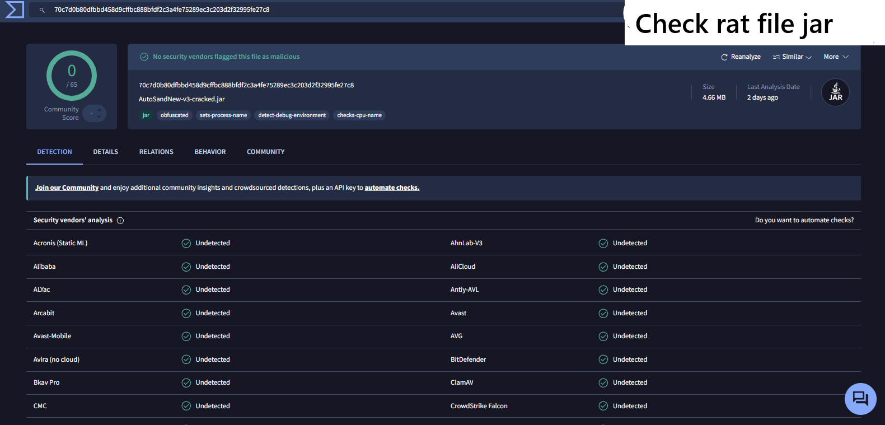

# autosand deobf v3 By Speedboy

Deobfuscated, cracked and Buildable `AutoSandNew-1.0.0.jar`.

## layout

```
src/main/java/autosand/     decompiled sources (Mojang official names), buildable
src/main/resources/         fabric.mod.json
src-original/autosand/      untouched decompiler output, for diffing
deobf/                      intermediary -> official jar (read-only reference)
libs/baritone.jar           nested jar extracted from the mod (intermediary)
libs/baritone-official.jar  same jar remapped to official names, compileOnly
build/libs/                 gradle output (autosand-premium-3.0.0.jar)
```

## pipeline (intermediary -> official)

1. `Remap in.jar deobf.jar map.tsv` — ASM ClassRemapper, Fabric intermediary -> Mojang official 1.21.11
2. `Check deobf.jar` — CheckClassAdapter structural pass (`ok=15 bad=0`)
3. `java -jar vineflower-1.11.1.jar --silent deobf.jar src`

Tools and mapping cache: `D:\project opencode\jailbreak\deobf_tools`,
`%TEMP%\opencode\deobf` (client.txt, intermediary.jar, map.tsv, asm jars, vineflower).

## build

```
JAVA_HOME=<jdk-25>            # Loom 1.19.1 requires JVM >= 25
gradle build                  # compile target stays Java 21
```

Output: `build/libs/autosand-premium-3.0.0.jar` (intermediary, runtime-ready).

## changes vs shipped AutoSandNew-1.0.0

- `AutoSandOrders$License` (382 lines of HTTP verification, key file, seal, expiry)
  replaced by a stub: `valid()` -> true, `status()` -> `CRACKED BY SPEEDBOY`,
  `init/activate/refreshIfNeeded` no-op.
- Every `PREMIUM` string gone: both `AUTOSAND PREMIUM` watermarks now read
  `CRACKED BY SPEEDBOY`; the footer key line shows `Key: CRACKED BY SPEEDBOY`.
- `AutoSandScreen`: Discord pill in the bottom-right corner of the screen,
  label `join discord for more crack`, opens `https://discord.gg/DS3RVbuJ8`.
  Drawn in `renderBackground` (blurple `0xFF5865F2`, hover `0xFF4752C4`,
  white Discord mark), click handled by an invisible `Button` added in `init()`.
- Decompiled sources needed five local-variable renames to recompile:
  `AutoMiner`: `r` -> `r2`; `AutoSandOrders`: `ix` -> `ixGear`/`ixAmt`/`ixConfirm`,
  `idx` -> `foodIdx` (each `case` block reused the same slot name).

## final jar

`AutoSandNew-1.0.0-cracked.jar` — pristine jar with the rebuilt `autosand/*`
classes swapped in; `fabric.mod.json` and `META-INF/jars/baritone.jar` kept
byte-identical from the original.

## Verification File,Source

### Full Source Check


### Rebuilt JAR Check


### Demonstration

<video src="img/Screen%20Recording%202026-11-01%20223830.mp4" controls width="100%">
  Your browser does not support embedded videos.
</video>

[Watch full recording](https://youtu.be/8Frt_72m6hM)

# Join Discord https://discord.gg/BcXJr5V6t6

# requirements

- Jdk 26 or higher
- HighIQ

# Build

Extract source folder
Open Source Folder
Open Command Prompts or PowerShell
Type 
```bash
.\gradlew.bat build
```
Enter and Jar will in 
```bash
build\libs\
```
